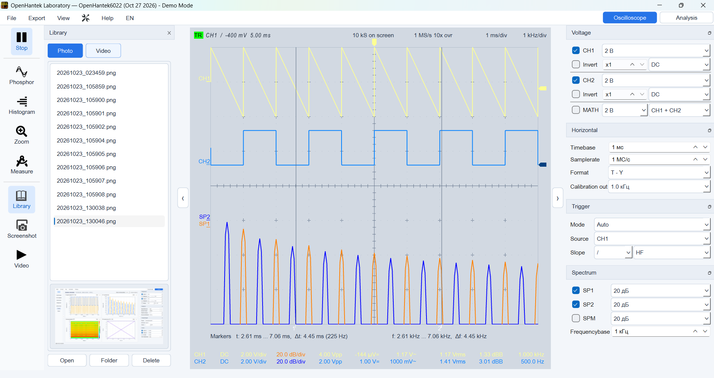
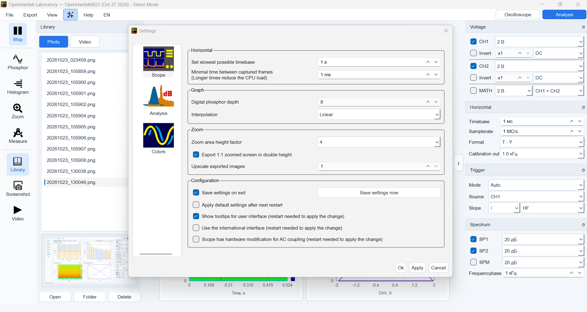

# OpenHantek Laboratory

**Multilingual oscilloscope and signal analysis for Hantek 6022 series**  
A laboratory-oriented Qt6 development branch of [OpenHantek6022](https://github.com/OpenHantek/OpenHantek6022), with an updated interface, a four-panel analysis workspace, a media library, and translation resources for ten languages.

[**Download Windows x64 (portable)**](https://github.com/arandit21/OpenHantek6022/releases/download/laboratory-multilingual-20261027/OpenHantek-Laboratory-Windows-x64-20261027.zip) · [**Releases**](https://github.com/arandit21/OpenHantek6022/releases/tag/laboratory-multilingual-20261027) · [**Source code**](https://github.com/arandit21/OpenHantek6022/tree/openhantek-laboratory-multilingual-20261027) · [**Laboratory notes**](LABORATORY_MULTILINGUAL.md)

## Oscilloscope

Two-channel waveform display (CH1 and CH2) with triggering, timebase, measurement readouts, and spectrum traces. The side panels provide quick access to measurement settings and captured media.



## Signal Analysis — four views

The **Analysis** tab brings four complementary ways of looking at the same signal into one workspace:

- **Oscilloscope CH1 / CH2** — time-domain waveforms.
- **FFT analyzer** — frequency-domain spectrum.
- **STFT spectrogram** — frequency content over time.
- **XY analyzer CH1 / CH2** — relationship between channels.


## Settings and multilingual interface

The interface is built with Qt6. The source tree contains translation resources for **English, German, Spanish, French, Italian, Polish, Portuguese, Russian, Swedish, and Chinese**. The program also includes interface settings for horizontal capture, graph interpolation, zoom, and configuration.



## Highlights

| Area | What is provided |
| --- | --- |
| Oscilloscope | CH1 / CH2 traces, trigger and horizontal controls, measurements |
| Analysis | Four-panel CH1/CH2, FFT, STFT, and XY workspace |
| Capture library | Photo and Video sections with image previews |
| Languages | Qt translation resources for 10 languages |
| Windows | Portable x64 application with Qt runtime files |
| Documentation | English and Russian manuals and modification guides |

**Screenshot context:** All three screenshots were captured in **Demo Mode** with simulated signals. They illustrate the interface, not a verified measurement of connected hardware. Some newer language-switching fixes in the published sources have not yet been independently verified in the compiled executable.

## Download and run

1. Download [**OpenHantek-Laboratory-Windows-x64-20261027.zip**](https://github.com/arandit21/OpenHantek6022/releases/download/laboratory-multilingual-20261027/OpenHantek-Laboratory-Windows-x64-20261027.zip).
2. Extract the **whole archive** into a folder. Keep the included DLLs and runtime files alongside the application.
3. Run **`OpenHantek-Lab.exe`** on Windows x64. The Demo Mode shown above is available for exploring the interface.

**Published EXE SHA-256:**

```text
922beb3ca68d66817c54b6794a9a82f2c2ff33bd235b64a674e9fef1527a5daa
```

[**Open the full release (Windows and sources)**](https://github.com/arandit21/OpenHantek6022/releases/tag/laboratory-multilingual-20261027)

## Source code, building and manuals

This branch includes the C++/Qt6 sources in [`openhantek/`](openhantek/), translation files in [`openhantek/translations/`](openhantek/translations/), and build definitions in [`CMakeLists.txt`](CMakeLists.txt) and [`openhantek/CMakeLists.txt`](openhantek/CMakeLists.txt). Qt6 LinguistTools is used to build the translations. Consult the build configuration and the upstream OpenHantek project for platform-specific prerequisites.

The English and Russian PDFs have the same organization as the Windows package:

| Language | In source repository | In portable Windows package |
| --- | --- | --- |
| English (4 PDFs) | [`docs/*.pdf`](docs/) | `documents/*.pdf` |
| Russian (4 PDFs) | [`docs/ru/*.pdf`](docs/ru/) | `documents/ru/*.pdf` |

For additional development notes, see [`LABORATORY_MULTILINGUAL.md`](LABORATORY_MULTILINGUAL.md) and [`LANGUAGES_FIX_README_RU.txt`](LANGUAGES_FIX_README_RU.txt).

## Original project and license

This is a separate development branch of the open-source [OpenHantek6022](https://github.com/OpenHantek/OpenHantek6022) project. All credit for the original application, drivers, instrument support, and earlier contributions belongs to the original developers and OpenHantek community. Licensing and notices remain in [`LICENSE`](LICENSE) and the source files.

The repository's **`main`** branch is preserved independently of this Laboratory branch.

---

**Русский:** OpenHantek Laboratory — мультиязычная лабораторная версия программы для Hantek 6022. В составе: два канала осциллографа, FFT, спектрограмма STFT, XY-анализ, библиотека снимков и видео. [Скачать Windows-версию](https://github.com/arandit21/OpenHantek6022/releases/tag/laboratory-multilingual-20261027).
