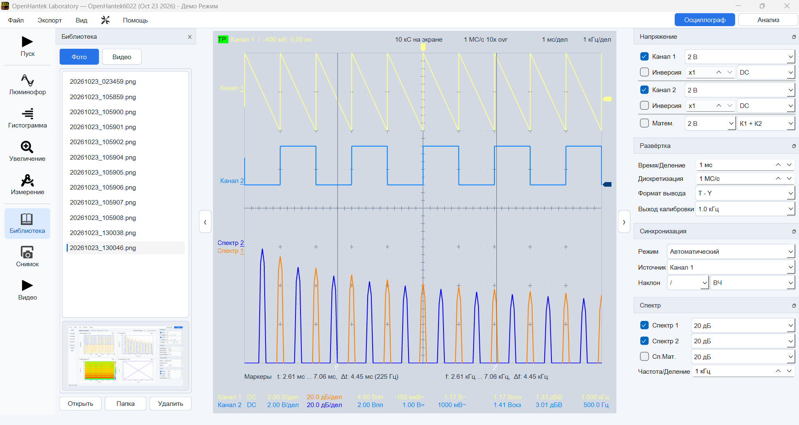
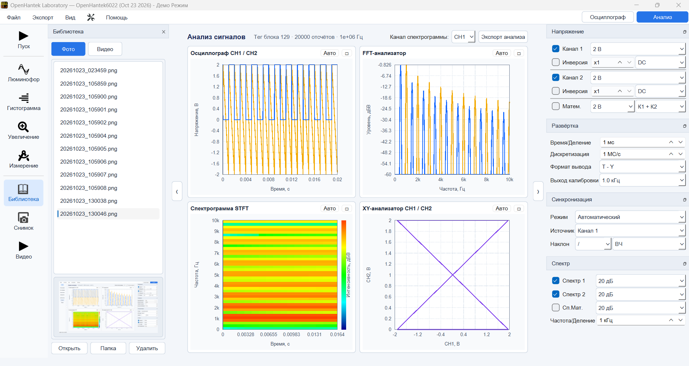

# OpenHantek Laboratory — Windows

Русская сборка приложения для двухканальных USB-осциллографов Hantek 6022BE/6022BL и совместимых моделей. Интерфейс и справочные материалы подготовлены для русскоязычных пользователей, в том числе в странах СНГ.

**[Скачать Windows x64 ZIP](https://github.com/arandit21/OpenHantek6022/releases/latest/download/OpenHantek-Laboratory-Windows-x64.zip)** · [Все релизы](https://github.com/arandit21/OpenHantek6022/releases)

Сборка основана на открытом проекте OpenHantek6022. Для работы с реальным прибором нужны совместимый осциллограф и установленный драйвер.

## Скриншоты

### Осциллограф

### Анализ сигналов

## Возможности

- Осциллограммы каналов CH1 и CH2 и измерение параметров сигнала.
- Спектр, БПФ, спектрограмма и XY-анализ.
- Отдельный режим анализа с экспортом результатов.
- Снимки экрана и запись видео измерений.
- Библиотека фотографий и видео; воспроизведение записей OHRAW.
- Демонстрационный режим для работы без подключённого прибора.

## Установка и запуск

1. Скачайте ZIP **Windows x64** и распакуйте его целиком в отдельную папку. Не запускайте программу прямо из архива.
2. Для демонстрации запустите **«Запустить OpenHantek Demo.bat»**. BAT-файл запускает программу с параметром `--demoMode`; прибор не требуется.
3. Для работы с осциллографом запустите **OpenHantek-Lab.exe** после подключения совместимого прибора и установки драйвера.
4. Оставьте EXE, DLL и папки из комплекта вместе.

В папке `documents` архива находятся русские руководство пользователя, инструкция по установке драйвера и материалы по аппаратным модификациям.

## Совместимость

Программа предназначена для Windows x64 и осциллографов Hantek 6022BE/6022BL и совместимых моделей. Деморежим работает без прибора.

Исходный проект: [OpenHantek6022](https://github.com/OpenHantek/OpenHantek6022).
